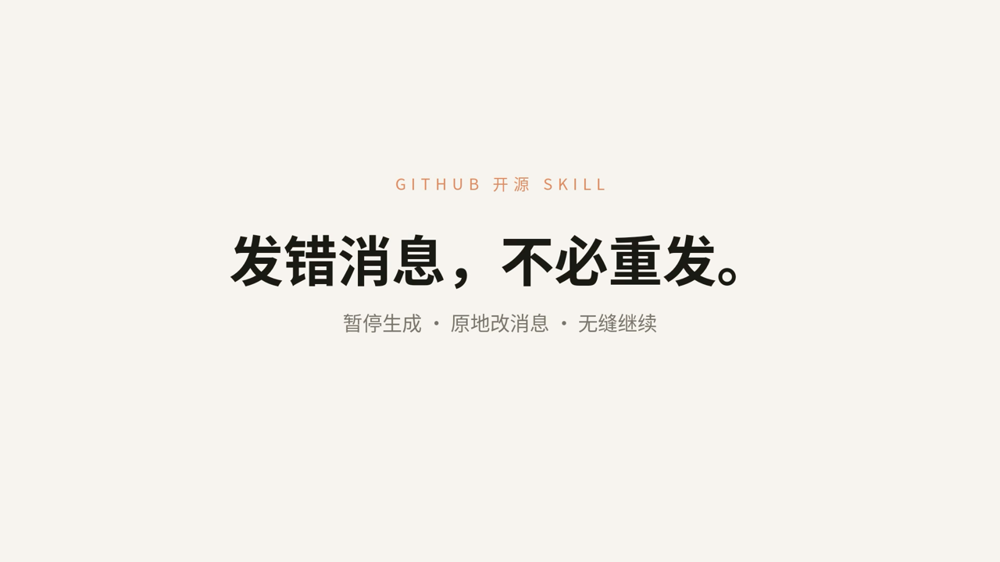
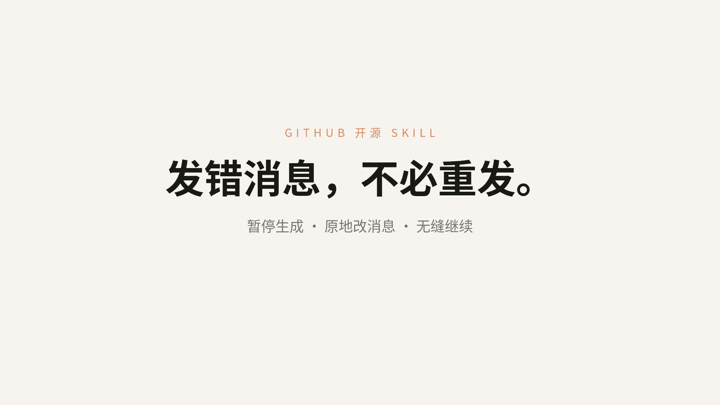

<h1 align="center">dsh-message-edit</h1>

<p align="center"><b>发错消息，不必重发。</b><br>暂停生成 · 原地改消息 · 无缝继续</p>

<p align="center">
  <a href="assets/skill-promo.mp4"></a>
</p>

<p align="center">▶ <a href="assets/skill-promo.mp4"><b>观看完整演示视频（35 秒 · 1080p）</b></a></p>

<p align="center">
  
</p>

<p align="center"><sub>上方动图为完整流程速览；点图片或链接观看高清完整视频</sub></p>

---

## 🎬 视频讲解

下面这段 35 秒演示，把“发错消息不用重发”的完整过程讲清楚了：

| 时间 | 画面 | 说明 |
| --- | --- | --- |
| 0:00 | 片头 | 「发错消息，不必重发。」——暂停生成 · 原地改消息 · 无缝继续 |
| 0:03 | **01 发错问题了** | 在输入框里发了一个问错的问题 |
| 0:09 | **02 先暂停生成** | 模型正在“深度求索”时，先点停，避免白白生成 |
| 0:12 | **03 点开原文，直接改** | 点已发送的消息，它就地变成编辑框，直接改文字；下方提示“发送后用修改内容替换这条消息；原会话会归档（可在‘归档’中恢复）” |
| 0:21 | **04 已替换，继续跑** | 点“发送”后旧消息被新内容替换、对话无缝继续 |
| 0:24 | **05 再错，再改** | 还不满意？可以再编辑一次 |
| 0:33 | 片尾 | 「发错了，就改它。」——暂停生成 / 原地编辑已发送消息 / 对话无缝继续 |

> 一句话：**点已发送的消息 → 就地改 → 发送 → 用新内容替换并继续**，不用再发一条新消息。

## 功能

- 鼠标悬停在任意一条**已发送的用户消息**上，气泡下方出现「复制」「编辑」。
- 点「编辑」，原气泡就地变成输入框（自动带入原文）。
- 点「发送」或回车：先停掉正在进行的回复（如有），以这条消息为界**回卷**——保留它之前
  完全相同的对话历史，丢弃这条消息及其之后的内容，再用修改后的文字重新生成。
- 原会话转入**归档**（可在「归档」中恢复）；当前视图呈现的就是这条消息被替换后的同一段对话。
- 支持 Enter 发送 / Shift+Enter 换行 / Esc 取消；中文输入法回车不误发。

## 原理（重要）

DSH 的可见聊天记录由**追加型事件**渲染，直接用「替换型 surface」只影响模型上下文、不会改动
屏幕上已有的旧气泡；内核也没有 truncate/回卷 API。因此本插件用
「在该消息处 fork（等价回卷）+ 用编辑后的文字重发 + 归档原会话」实现「覆盖」：

- fork 原样保留该消息**之前**的全部历史，只丢弃该消息及其之后；
- 所以看起来就是这条消息被替换、后面的内容被重来；
- 原会话放在「归档」里，可恢复（不是永久删除）。

如需**永久删除**原会话，或内核级的「同一条会话原地改写」，需要更深的内核改动。

## 作为 DSH 插件安装

依赖：DeepSeek Harness（桌面版，profile 机制）。

1. 把本仓库放到一个稳定目录，例如 `~/.dsh/plugins/dsh-message-edit`：

   ```bash
   git clone https://github.com/XuYuanDaWang/dsh-message-edit.git ~/.dsh/plugins/dsh-message-edit
   ```

2. 在 DSH 的 profile（默认 `~/.dsh/profiles/desktop/package.json`）里：
   - `dependencies` 增加：`"@local/dsh-message-edit": "link:/绝对路径/.dsh/plugins/dsh-message-edit"`
   - `dsh.profile.bundles` 增加：`"@local/dsh-message-edit"`

3. 安装依赖并重启应用（或「设置 → 插件」重新开关一次）：

   ```bash
   cd ~/.dsh/profiles/desktop && pnpm install
   ```

   然后**完全退出 DeepSeek Harness（⌘Q）并重开**。

> 插件声明的包名是 `@local/dsh-message-edit`；`dsh.profile.bundles` 里要写这个包名。

## 作为 DSH Skill

仓库根目录的 `SKILL.md` 是标准 DSH 技能说明（含 `name` / `description` / `whenToUse`）。
把它（或整个目录）放到 `~/.dsh/skills/` 下，Agent 就能理解这个功能的用途与安装/使用方式。
注意：`SKILL.md` 只是说明；真正让「编辑」按钮出现，仍需要按上面的方式**安装插件**。

## 文件

- `assets/` —— 演示视频 `skill-promo.mp4`、流程速览 `preview.gif`、封面图。
- `client.js` —— Web 客户端：覆盖用户消息节点、编辑态、复制/编辑动作、回卷替换 + 归档流程。
- `index.js` —— 服务端入口（空实现，仅让 bundle 可加载并下发客户端模块）。
- `cordis.patch.yml` —— 声明把本插件插入 DSH 加载树。
- `locale/{zh,en}.json` —— 插件市场标题/简介。
- `icon.svg` —— 插件图标。
- `SKILL.md` —— 标准 DSH 技能说明。
- `regression.test.cjs` —— 无浏览器逻辑回归：`node regression.test.cjs`。

## 测试

```bash
node regression.test.cjs
```

## License

MIT
